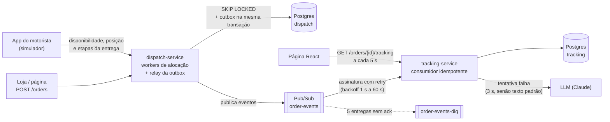

# lastmile-go

[](https://github.com/Kaylan00/lastmile-go/actions/workflows/ci.yml)

Dois microsserviços em Go para entrega de última milha:

- **dispatch-service** aloca cada pedido ao motorista livre mais próximo. A garantia de que dois motoristas
  nunca pegam o mesmo pedido está no banco: uma transação com `SELECT ... FOR UPDATE SKIP LOCKED`, testada com
  100 goroutines disputando 10 motoristas e `go test -race`.
- **tracking-service** consome os eventos da rota pelo Pub/Sub (idempotente por `event_id`, com retry e
  dead-letter) e expõe status e previsão de chegada por API, que uma página React mostra ao comprador.
  Quando a entrega falha, um LLM escreve a mensagem para o comprador, com prazo de 3 s e texto padrão se falhar.

**Demo:** <https://lastmile-go.vercel.app> (clique em "Criar um pedido de teste" e acompanhe a entrega).

> A demo publicada é uma função serverless que roda o código Go do tracking (máquina de estados,
> aplicação dos eventos e ETA) com uma entrega simulada em memória e acelerada. Ela não usa Postgres
> nem Pub/Sub. O sistema completo sobe com `docker compose up` (abaixo), e o deploy no Cloud Run está
> pronto em [`deploy/cloudrun.sh`](deploy/cloudrun.sh).

## Arquitetura



O caminho de um pedido:

1. `POST /orders` grava o pedido (`pending`) e o evento `order.created` na tabela **outbox**, na mesma transação.
2. Um **worker** pega o pedido pendente mais antigo e o motorista livre mais próximo da coleta, os dois com
   `FOR UPDATE SKIP LOCKED`, e grava a alocação e o evento `order.assigned`, de novo na mesma transação.
3. O **relay** lê a outbox e publica no Pub/Sub. Se o Pub/Sub estiver fora, o evento espera na tabela.
4. O app do motorista informa posição e etapas (`picked_up`, `out_for_delivery`, `delivered` ou
   `failed_attempt`); cada uma vira um evento pelo mesmo caminho.
5. O **tracking** registra o `event_id` (duplicado é ignorado), aplica o evento ao estado do pedido (o status
   só avança) e só depois confirma a mensagem (ack). Erro temporário = nack, e o Pub/Sub entrega de novo com
   backoff; depois de 5 tentativas a mensagem vai para a dead-letter.
6. `GET /orders/{id}/tracking` devolve status, posição do motorista, ETA e a linha do tempo.

## Como rodar

Precisa de Docker. Sobe Postgres, o emulador oficial do Pub/Sub, os dois serviços, um simulador de
motoristas e a página:

```bash
docker compose up --build
```

Abra <http://localhost:3000> e clique em **Criar um pedido de teste**. O simulador registra 6 motoristas
perto da Av. Paulista e "dirige" cada entrega a 60 km/h (o ETA do compose usa a mesma velocidade, para a
previsão bater com o mapa).

As APIs também ficam expostas: dispatch em `localhost:8080`, tracking em `localhost:8081`.

```bash
# motorista livre
curl -X POST localhost:8080/drivers/moto-99/availability \
  -d '{"available": true, "position": {"lat": -23.5510, "lng": -46.6340}}'

# pedido novo (o worker aloca em milissegundos)
curl -X POST localhost:8080/orders \
  -d '{"pickup": {"lat": -23.5505, "lng": -46.6333}, "dropoff": {"lat": -23.5614, "lng": -46.6559}}'

# rastreio
curl localhost:8081/orders/<id>/tracking
```

**Testes** (os de integração usam o Postgres do compose; sem banco eles são pulados, e no CI falham):

```bash
make test-integration        # docker compose up -d postgres + go test -race ./...
go test -race ./...          # só os que não precisam de banco
```

**Demo sem Docker** (a mesma da Vercel):

```bash
cd web && npm ci && VITE_DEMO=true npm run build && cd ..
go run ./cmd/demo            # http://localhost:8090
```

Com `ANTHROPIC_API_KEY` definida, o tracking usa o LLM na tentativa de entrega falha; sem ela, usa sempre o
texto padrão. Todas as variáveis estão em [`.env.example`](.env.example).

## API

| Serviço | Rota | O que faz |
|---|---|---|
| dispatch | `POST /orders` | cria pedido (`pickup`, `dropoff`) |
| dispatch | `GET /orders/{id}` | pedido e motorista alocado |
| dispatch | `POST /drivers/{id}/availability` | motorista livre (com posição) ou offline |
| dispatch | `GET /drivers/{id}` | situação do motorista e pedido atual |
| dispatch | `POST /drivers/{id}/location` | posição atual; gera `order.location_updated` se estiver com pedido |
| dispatch | `POST /orders/{id}/events` | etapa informada pelo motorista (`picked_up`, `out_for_delivery`, `delivered`, `failed_attempt`) |
| tracking | `GET /orders/{id}/tracking` | status, posição, ETA, mensagem e linha do tempo |
| os dois | `GET /health`, `GET /ready` | liveness e readiness (o `/ready` checa o banco e dá 503 no desligamento) |

## Decisões

**Alocação no banco, com `FOR UPDATE SKIP LOCKED`, e não com mutex.** No Cloud Run rodam várias réplicas
(processos separados); um `sync.Mutex` só protege dentro de um processo. `FOR UPDATE` trava a linha até o fim
da transação e `SKIP LOCKED` faz o outro worker pular a linha travada em vez de esperar. Se o motorista mudar
de status entre a leitura e o lock, o Postgres reavalia o `WHERE` na versão nova da linha e a descarta. Além
disso, um índice único parcial impede um motorista de ter dois pedidos ativos mesmo se o código errar
([`migrations/dispatch/001_orders_drivers.sql`](migrations/dispatch/001_orders_drivers.sql)).

**Outbox.** Gravar no banco e depois publicar no Pub/Sub tem uma janela: se o processo cair entre as duas
coisas, o evento se perde. Com a outbox, a mudança e o evento entram na mesma transação, e o relay publica
depois, quantas vezes precisar. O custo é entrega "pelo menos uma vez": o relay pode publicar de novo se cair
depois de publicar e antes de marcar `published_at`.

**Consumidor idempotente.** Como o Pub/Sub também entrega pelo menos uma vez, o tracking grava o `event_id`
numa tabela com chave primária (`INSERT ... ON CONFLICT DO NOTHING`) na mesma transação que aplica o evento.
Se a mesma mensagem chegar duas vezes, inclusive em duas réplicas ao mesmo tempo, só uma aplica. O ack só
acontece depois do commit.

**Eventos fora de ordem.** Em vez de ordering keys do Pub/Sub, o consumidor aceita qualquer ordem: o status
só avança (um `picked_up` atrasado não desfaz um `delivered`), a posição só troca por uma mais nova e todo
evento carrega coleta e entrega, então qualquer um pode ser o primeiro a chegar. A regra é uma função pura
(`tracking.Apply`), testada com 500 ordens sorteadas com repetições.

**Retry e dead-letter.** Erro temporário (banco fora) devolve nack e o Pub/Sub tenta de novo com backoff
exponencial (retry policy da assinatura); depois de 5 entregas, a mensagem vai para `order-events-dlq`.
Mensagem inválida (JSON quebrado, campo faltando) vai direto para a dead-letter, porque repetir não resolve.

**Concorrência com limite.** O pool de alocação tem tamanho fixo, o consumidor tem `MaxOutstandingMessages`
e toda chamada externa tem `context` com prazo. Se o banco ficar lento, o trabalho espera (pedidos `pending`
na tabela, mensagens no Pub/Sub) em vez de virar milhares de goroutines.

**Graceful shutdown.** No SIGTERM: o `/ready` passa a responder 503, o servidor HTTP termina as requisições
em andamento, cada worker termina a transação que começou (usa `context.WithoutCancel` com prazo próprio), o
consumidor espera as mensagens em processamento e o publisher envia o que estava no buffer.

**Um banco por serviço.** Cada serviço tem o seu banco e as suas migrations; o tracking não lê tabelas do
dispatch. O contrato entre eles é o formato do evento ([`internal/events`](internal/events/events.go)).

**LLM fora do caminho crítico.** A chamada acontece antes da transação (não segura lock esperando a rede),
tem prazo de 3 s e qualquer problema (timeout, erro, recusa, resposta vazia, longa, com link) cai no texto
padrão. O texto do motorista vai entre marcadores, com `<` e `>` trocados, e o prompt diz que ele é só
informação (prompt injection). Mensagem repetida não chama o LLM de novo.

**Só biblioteca padrão onde dá.** Roteamento do `net/http` (Go 1.22+), `log/slog` em JSON com os campos que
o Cloud Logging entende, `context`, `errors`. Dependências: `pgx` (Postgres) e o client oficial do Pub/Sub.
A chamada ao LLM é um `POST` com `net/http`. As migrations são arquivos SQL embutidos no binário
(`go:embed`), aplicados na subida com `pg_advisory_lock` para duas réplicas não migrarem juntas.

**ETA simples e explicável.** Distância restante em linha reta (Haversine) × fator de rota ÷ velocidade
média. Antes da coleta, a distância é motorista → coleta → comprador; depois, motorista → comprador. A
velocidade (20 km/h) e o fator (1,3) são suposições configuráveis, não medições.

## Testes

| Teste | O que prova |
|---|---|
| `TestAssignNext_100GoroutinesCompeteFor10Drivers` | 100 goroutines, 10 motoristas, Postgres real e `-race`: exatamente 10 alocações, nenhuma duplicada |
| `TestAssignNext_SkipsRowsLockedByAnotherTransaction` | com outra transação segurando os locks, a alocação pega as próximas linhas sem esperar |
| `TestDatabaseConstraints` | o banco recusa estado inválido (ex.: dois pedidos ativos no mesmo motorista) |
| `TestRelayKeepsEventsWhilePubSubIsDown` | com o Pub/Sub fora, o evento fica na outbox e sai quando ele volta |
| `TestProcess_ConcurrentDuplicates` | a mesma mensagem em 20 goroutines é aplicada uma vez |
| `TestApply_AnyOrderSameResult` | 500 ordens sorteadas, com repetição, dão o mesmo estado final |
| `TestConsumerWithPubSub` | fluxo com o Pub/Sub falso do Google (`pstest`): fora de ordem, repetição e dead-letter |
| `TestNackGoesToDeadLetterAfterMaxAttempts` | depois de 5 nacks a mensagem vai para a dead-letter |
| `TestBuyerMessage` | LLM lento, com erro ou resposta ruim caem no texto padrão dentro do prazo |
| `TestServeGracefulShutdown` | requisição em andamento termina com 200 depois do SIGTERM |

Os testes de geo, ETA, máquina de estados, retry e validações são table-driven. O CI roda `gofmt`, `go vet`,
`go test -race` com um Postgres de serviço, o build da página e das imagens.

Não há números de desempenho neste README porque não foi feito teste de carga.

## O que ele não faz

- **A alocação é gulosa:** pedido mais antigo primeiro, motorista mais próximo dele. Não é uma otimização
  global (problema de atribuição). E o `ORDER BY haversine_km(...)` percorre todos os motoristas livres; com
  muitos motoristas seria preciso um índice geográfico (PostGIS com GiST, ou células H3/geohash).
- **O ETA não conhece ruas nem trânsito:** é linha reta × fator. Em produção viria de uma API de rotas ou do
  histórico de entregas.
- **Sem autenticação:** qualquer um chama a API do motorista. Em produção cada app teria token.
- **A outbox não é limpa:** linhas publicadas ficam na tabela (faltaria um job apagando as antigas). O relay
  segura o lock do lote enquanto publica, o que é aceitável para lotes pequenos.
- **Posições passam pela outbox e pelo Pub/Sub** como os outros eventos. Com muitos motoristas mandando
  posição a cada poucos segundos, o certo seria um fluxo separado.
- **Tentativa falha é o fim do pedido:** uma nova tentativa seria um pedido novo.
- **Só logs:** não há métricas nem tracing.
- **A demo publicada não usa Postgres nem Pub/Sub** (ver o aviso no topo). O deploy no Cloud Run está
  automatizado em `deploy/cloudrun.sh`, mas precisa de um projeto GCP com faturamento para rodar.

## Estrutura

```
cmd/dispatch, cmd/tracking   main de cada serviço (config, ligação das peças, shutdown)
cmd/simulator                faz o papel do app dos motoristas no docker-compose
cmd/demo                     demo em memória sem Docker
internal/dispatch            pedidos, motoristas, alocação (SKIP LOCKED), outbox, workers, API
internal/tracking            consumidor idempotente, Apply (estado), API de rastreio
internal/events              contrato dos eventos entre os serviços
internal/order               status do pedido e regras de transição
internal/geo, internal/eta   Haversine e previsão de chegada
internal/notify              mensagem do comprador com LLM, prazo e texto padrão
internal/platform            config, logs, HTTP, Postgres, migrations, Pub/Sub, retry
migrations/                  SQL de cada serviço (embutido no binário)
demo/, api/                  demo da Vercel (função serverless)
web/                         página React (Vite + TypeScript + Leaflet)
deploy/                      Dockerfile, script do Cloud Run, init do Postgres
```
